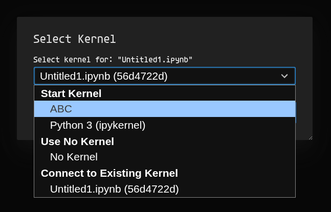

{fig-align="center" width=40%}

What I, and probably you, want:

1. Not to install Jupyter into every project, where you would like to use it for
   something. Ideally into none of them.
2. Have just one instance of Jupyter installed on your system, not to clutter it.
   Keep it tidy. (With an option to install more versions if needed).
3. Be able to launch Jupyter on-demand, without being in an environment of any
   project, with a small, predefined set of default packages. (You want to quickly
   learn a bit about an epst.csv someone sent you, but you don't want to create a whole new
   development env with its own flake/shell and so on).
4. Not copy the whole ~csv to the nix store for some reason every time you make a
   change -_-.

This is not that hard if what you need to do for your project does not demand any
more libraries than those that are a part of your predefined set of default packages.
But many times you will need project-specific, heavier packages, or packages that you
don't want to include in your default set. Kernels will be needed.

The global Jupyter flake.nix:

```nix
{
  description = "Global JupyterLab shell";

  inputs = {
    nixpkgs.url = "github:NixOS/nixpkgs/nixos-unstable";
    flake-utils.url = "github:numtide/flake-utils";
  };

  outputs =
    {
      self,
      nixpkgs,
      flake-utils,
    }:
    flake-utils.lib.eachDefaultSystem (
      system:
      let
        pkgs = import nixpkgs { inherit system; };
        jupyter = pkgs.python3.withPackages (p: [
          p.jupyterlab
          p.pandas
        ]);
      in
      {
        apps.unregister-kernel = {
          type = "app";
          program = "${pkgs.writeShellScriptBin "unregister-kernel" ''
            set -euo pipefail
            if [ $# -lt 1 ]; then
              echo "Forgot kernel name"
              echo "Usage: nix run .#unregister-kernel <kernel-name>"
              exit 1
            fi
            ${jupyter}/bin/jupyter kernelspec uninstall -f "$1"
            echo "Kernel unregistered."
          ''}/bin/unregister-kernel";
        };

        devShells.default = pkgs.mkShell {
          packages = [ jupyter ];
          shellHook = "jupyter lab";
        };
      }
    );
}
```

We'll get to `unregister-kernel` in a moment.

Add a shell alias that `nix develop`s this flake, regardless where you are
on your file system (Jupyter will open where you run the command):
```python
"jp" = "nix develop ~/.jupyter_flake";
```

Running it will automatically launch and open the GUI in the browser, with pandas and
its dependencies ready to use.

This would be it, if you didn't need any of your project specific packages.

My approach is to put an "`app`" inside of my project flake.nix that is responsible
for registering a Jupyter kernel. For this to work you need to add `ipykernel` to
your project (e.g., `uv add ipykernel`).

Gutted example of a project flake (full at the bottom):
```nix
# ==  ==  ==  ==
  outputs =
    {
      # ==  ==  ==  ==
    }:
    flake-utils.lib.eachDefaultSystem (
      system:
      let
        projectName = "ABC";
        venvName = ".venv";
        # ==  ==  ==  ==
        # ==  ==  ==  ==
        # ==  ==  ==  ==
        venv = pythonSet.mkVirtualEnv "${venvName}" workspace.deps.default;
      in
      {
        apps.register-kernel = {
          type = "app";
          program = "${pkgs.writeShellScriptBin "register-kernel" ''
            set -euo pipefail
            export PATH="${venv}/bin:$PATH"
            python -m ipykernel install \
              --user \
              --name="${projectName}" \
              --display-name="${projectName}"
            echo "Kernel registered."
          ''}/bin/register-kernel";
        };

        devShells.default = pkgs.mkShell {
          # ==  ==  ==  ==
        };
      }
    );
}
```

With that, I have a command inside my development shell that is tab-completable, and
it automatically registers the kernel with the correct name.

You can run it both inside and outside of your development shell:
```json
nix run .#register-kernel
```

`set -euo pipefail` in the script is meant to make it fail fast and
predictably in case something goes wrong inside.

In case I want to unregister a kernel, I've added `unregister-kernel` to the global
Jupyter flake. It takes one argument, which is the name of the kernel, as visible in
Jupyter itself (if `name` and `display-name` are the same).

{fig-align="center" width=50%}

This will work, but there is a slight problem. If you add a package to your project,
the kernel will not pick it up. When I was hacking on it and testing it, I forgot nix
is nix, and it took me some time to understand why only one of my packages was missing.

When you register a kernel, that env will go to the read-only store with its
designated hash. `ipykernel` will link against that.

User kernels are stored at `~/.local/share/jupyter/kernels/`. You could remove them
manually from there, or write a small script utilizing `fzf` to do that.

```text
├── kernels
│   └── kernel_name
│       ├── kernel.json
│       ├── logo-32x32.png
│       ├── logo-64x64.png
│       └── logo-svg.svg
```

Example kernel.json:
```json
{
 "argv": [
  "/nix/store/i8mi8f1p9d741hx1xz3g2s2qz8xj1sxy-venv/bin/python3.12",
  "-Xfrozen_modules=off",
  "-m",
  "ipykernel_launcher",
  "-f",
  "{connection_file}"
 ],
 "display_name": "ABC",
 "language": "python",
 "metadata": {
  "debugger": true
 }
}
```

It will contain a link to the nix store.

After you updated your project's packages, if you need them in a notebook, you will
need to rerun the `register-kernel` command.

This will override the kernel, switching just the link to the nix store. If you're in a
notebook with the newly overridden kernel, then you will have to re-pick it from the
menu (nothing will change from the user perspective) or restart Jupyter.

The first environment will not disappear from the nix store on its own. It will when
you garbage-collect your system.

However, if you garbage-collect your system, all of the environments linked in all `kernel.json`s
will be invalid (just like all the dev envs by default). This might cause confusion
because you will still see them listed in Jupyter. You will have to re-register
ones you want to use, or go with the approach used in [nix-direnv](https://github.com/nix-community/nix-direnv).

::: {.callout-note title="One of `nix-direnv`'s features" appearance="simple"}
> Prevents garbage collection of build dependencies by symlinking the resulting shell
> derivation in the user's gcroots (Life is too short to lose your project's build
> cache if you are on a flight with no internet connection).
:::

#### One more thing

Remember that, as of now, out-of-repository `flake.nix` + `nix develop` copies the whole directory
to the store. Not ideal.

To deal with that, I recommend either putting `flake.nix` into its own subfolder with
no children, or creating a minimal git repo with just `flake.nix` and `flake.lock`
there (and things like `pyproject.toml`, `uv.lock`, `.python-version`, `.env` if
needed) (it will copy only what is tracked by git into the store).

If your project is under a VCS already, avoid tracking any large files (git, if you're
using it, does not like that already). Otherwise, good luck.  

- See also:  
  - [https://discourse.nixos.org/t/my-painpoints-with-flakes/9750/20](https://discourse.nixos.org/t/my-painpoints-with-flakes/9750/20)  
  - [https://discourse.nixos.org/t/my-painpoints-with-flakes/9750/22](https://discourse.nixos.org/t/my-painpoints-with-flakes/9750/22)

Here are some resources on that:  
  - [Flakes without Git copies entire tree to Nix store](https://discourse.nixos.org/t/flakes-without-git-copies-entire-tree-to-nix-store/10743)  
  - [Copy local flakes to the store lazily](https://github.com/NixOS/nix/issues/3121)

#### Full flake example as promised (uv2nix)

```nix
{
  description = "uv2nix flake";

  inputs = {
    nixpkgs.url = "github:NixOS/nixpkgs/nixos-unstable";
    flake-utils = {
      url = "github:numtide/flake-utils";
    };
    pyproject-nix = {
      url = "github:pyproject-nix/pyproject.nix";
      inputs.nixpkgs.follows = "nixpkgs";
    };
    uv2nix = {
      url = "github:pyproject-nix/uv2nix";
      inputs.pyproject-nix.follows = "pyproject-nix";
      inputs.nixpkgs.follows = "nixpkgs";
    };
    pyproject-build-systems = {
      url = "github:pyproject-nix/build-system-pkgs";
      inputs.pyproject-nix.follows = "pyproject-nix";
      inputs.uv2nix.follows = "uv2nix";
      inputs.nixpkgs.follows = "nixpkgs";
    };
  };

  outputs =
    {
      self,
      nixpkgs,
      flake-utils,
      uv2nix,
      pyproject-nix,
      pyproject-build-systems,
      ...
    }:
    flake-utils.lib.eachDefaultSystem (
      system:
      let
        projectName = "ABC";
        venvName = ".venv";
        python = pkgs.python312;
        pkgs = import nixpkgs {
          inherit system;
        };
        workspace = uv2nix.lib.workspace.loadWorkspace { workspaceRoot = ./.; };
        overlay = workspace.mkPyprojectOverlay {
          sourcePreference = "wheel";
        };
        pyprojectOverrides = final: prev: {
          # Implement build fixups here.
          antlr4-python3-runtime = prev.antlr4-python3-runtime.overrideAttrs (old: {
            buildInputs = (old.buildInputs or [ ]) ++ [ final.setuptools ];
          });
        };
        pythonSet =
          (pkgs.callPackage pyproject-nix.build.packages {
            inherit python;
          }).overrideScope
            (
              pkgs.lib.composeManyExtensions [
                pyproject-build-systems.overlays.default
                overlay
                pyprojectOverrides
              ]
            );
        venv = pythonSet.mkVirtualEnv "${venvName}" workspace.deps.default;
      in
      {
        apps.register-kernel = {
          type = "app";
          program = "${pkgs.writeShellScriptBin "register-kernel" ''
            set -euo pipefail
            export PATH="${venv}/bin:$PATH"
            python -m ipykernel install \
              --user \
              --name="${projectName}" \
              --display-name="${projectName}"
            echo "Kernel registered."
          ''}/bin/register-kernel";
        };

        devShells.default = pkgs.mkShell {
          packages = [
            python
            pkgs.uv
          ];
          env = {
            UV_PYTHON_DOWNLOADS = "never";
            UV_PYTHON = python.interpreter;
          }
          // pkgs.lib.optionalAttrs pkgs.stdenv.isLinux {
            LD_LIBRARY_PATH = pkgs.lib.makeLibraryPath pkgs.pythonManylinuxPackages.manylinux1;
          };
          shellHook = ''
            unset PYTHONPATH
            [[ -f .env ]] && set -a && source .env && set +a
            [[ $DEVSHELL_SHELL ]] && exec "$DEVSHELL_SHELL"
          '';
        };
      }
    );
}
```

I ran into an error when trying to run `register-kernel`:
```text
ModuleNotFoundError: No module named 'setuptools'
DEBUG Released lock at `/build/uv-setuptools-8fa343bcb8a9d1d0.lock`
  x Failed to build `/build/antlr4-python3-runtime-4.9.3`
```

So I added an override to `pyprojectOverrides` to solve it. I based this fixup
on [pyproject2nix's edgecases section in the
docs](https://github.com/nix-community/poetry2nix/blob/8ffbc64abe7f432882cb5d96941c39103622ae5e/docs/edgecases.md#modulenotfounderror-no-module-named-packagename).

That wraps it up. Got a better way? Happy nixing.
